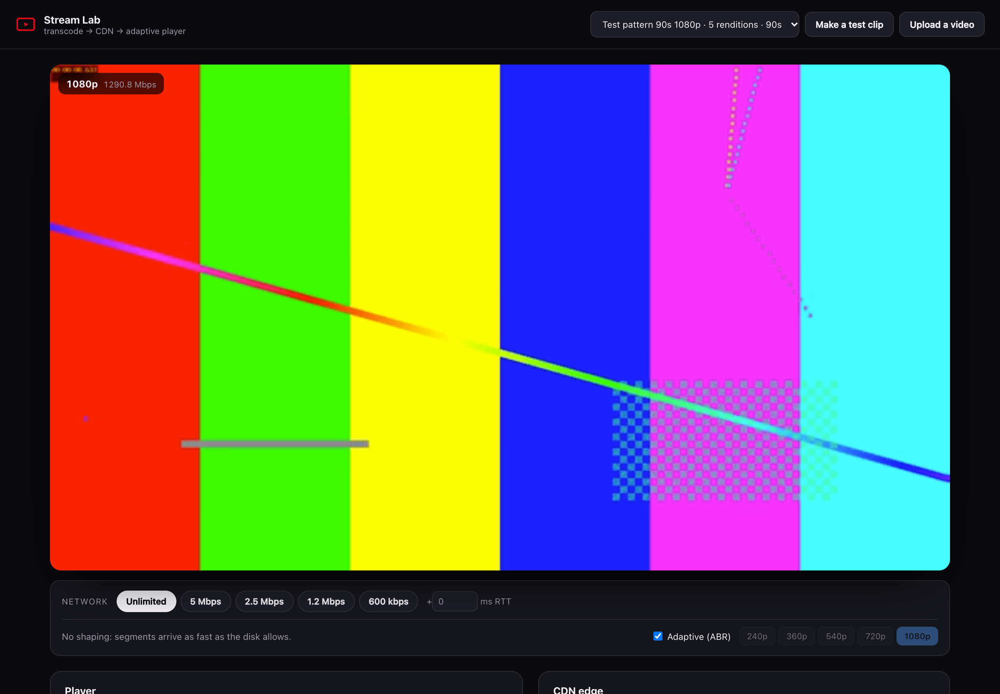
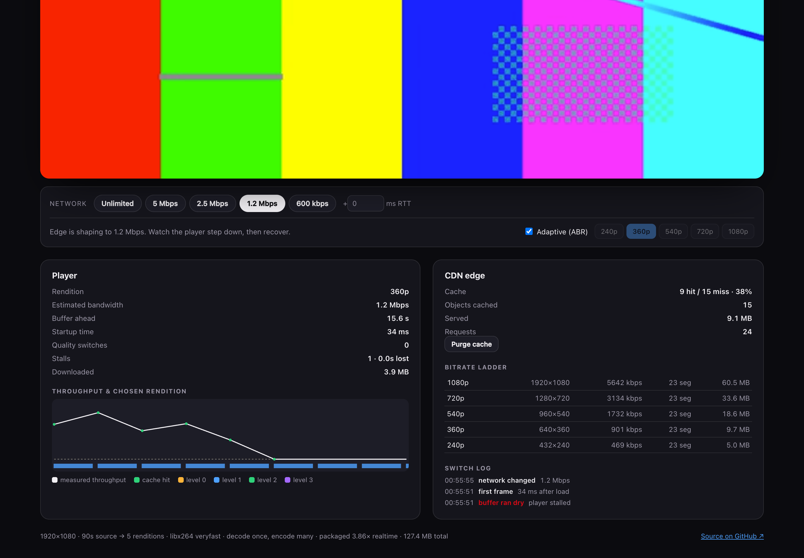
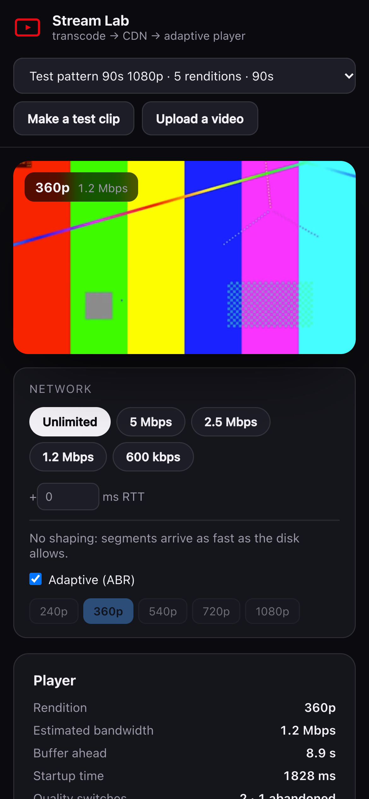

# Stream Lab

**Build your own Netflix: a video goes in, an adaptive bitrate ladder comes out, a simulated CDN serves it, and an ABR player I wrote from scratch decides what quality you get.**

Then you throttle the network from the UI and watch the player notice, abandon a download that is going nowhere, step down the ladder, and climb back when the link recovers.



```bash
npm install
npm start            # http://localhost:8080 → "Make a test clip" and watch
npm test             # 15 unit + integration tests (real ffmpeg, real HTTP)
npm run test:e2e     # drives Chrome: transcode → play → throttle → recover
npm run bench        # transcode throughput + ABR behaviour across 6 network profiles
```

Requires **ffmpeg** (`brew install ffmpeg`) and Node 18+. No frameworks, no `hls.js`, no media libraries: the packager, the CDN edge and the player are all in this repo. The only runtime dependency is `puppeteer-core`, and that is dev-only.

---

## What it does

**1. Transcode.** Upload any video (or generate a test clip) and ffmpeg encodes it into a five-rung ladder, 240p → 1080p, packaged as fMP4/CMAF segments with an HLS playlist per rendition and a master playlist on top. Keyframes are forced every 4 seconds with scene-cut insertion off, so **segment N covers the same moment in every rendition** and the player can switch at any boundary.

**2. Serve.** A small CDN edge caches segments with TTLs, reports `x-cache: HIT|MISS`, and can **shape bandwidth and add latency**. Shaping happens at the edge, not in the browser, so the bytes genuinely arrive slowly and the player's own logic has to cope.

**3. Play.** A hand-written HLS player parses the playlists, feeds segments into a MediaSource, and picks the rendition from measured throughput plus how much buffer is left.



---

## The ABR algorithm

The interesting part. Every rule below exists because of something that went wrong in testing.

| Rule | Why |
|---|---|
| Throughput is an **EWMA** (α = 0.35) of real segment downloads | One slow request should not panic the ladder |
| Only **cache misses** update the estimate | A cache hit says nothing about the network |
| Switch **down immediately** when the buffer looks unsafe | A stall is far worse than a soft picture |
| Switch **up** only with ≥6 s of buffer, and never within 2.5 s of the last switch | Stops the quality oscillating when throughput sits between two rungs |
| When switching up, **jump straight to the best affordable rung** | Climbing one step at a time wasted a good connection: this change alone raised average delivered bitrate on an 8 Mbps link from **2155 kbps to 3278 kbps (+52%)** with no extra stalls |
| **Abandon a download in flight** if the remaining bytes cannot arrive before the buffer drains | The trap that broke my first version. A 540p segment on a suddenly-600 kbps link took 11.5 s to arrive, so the next decision came far too late and playback stalled. Now the player gives up at ~400 ms, drops a rung and refetches |
| Cap the lookahead by **both buffered seconds and playlist time already fetched** | On a fast link the player swallowed the whole file in 30 ms, so ABR never got another decision point |

---

## Results

Measured on an Apple M4, 10 cores, Node 18, Chrome headless.

### Packaging

`npm run bench` compares four strategies on a 60 s 1080p source:

| Pipeline | Wall | × realtime |
|---|---:|---:|
| **Decode once, encode many** (one ffmpeg, `split` to 5 encoders) | **13.4 s** | **4.48×** |
| One process per rendition, 5 in parallel | 18.0 s | 3.34× |
| One process per rendition, serial | 21.3 s | 2.81× |
| Decode once, hardware encoder (VideoToolbox) | 17.4 s | 3.45× |

- **Decoding once is 1.34× faster than running five ffmpegs in parallel**, and 1.59× faster than serial. Parallel processes barely beat serial because each x264 already saturates every core, so the only real win is removing the duplicated decode.
- The **hardware encoder was slower** here (all five streams share one VideoToolbox queue) but produced **23% smaller files** for the same bitrate targets.

Ladder from a 1920×1080 source: 432×240 @ 469 kbps, 640×360 @ 901, 960×540 @ 1732, 1280×720 @ 3134, 1920×1080 @ 5642 (measured, not targets).

### Playback

`npm run bench` also plays the same clip through six network profiles, 26 s each:

| Network | Startup | Avg delivered | Switches | Abandoned | Stalls | Time lost |
|---|---:|---:|---:|---:|---:|---:|
| Unlimited (local disk) | 62 ms | 3061 kbps | 1 | 0 | 1 | 0.3 s |
| Good wifi, 8 Mbps | 511 ms | 3278 kbps | 1 | 0 | 1 | 0.5 s |
| Cafe wifi, 2.5 Mbps | 1481 ms | 1308 kbps | 2 | 1 | 1 | 1.4 s |
| Mobile 3G, 1.2 Mbps | 2560 ms | 503 kbps | 1 | 1 | 1 | 2.3 s |
| Bad train, 600 kbps | 4756 ms | 518 kbps | 1 | 1 | 1 | 4.3 s |
| **Drops mid-play, 8 → 0.6 Mbps** | 511 ms | 2198 kbps | 7 | 4 | 1 | 0.5 s |

The last row is the one that matters: when the link collapses by 13× mid-playback, the player abandons four doomed downloads, walks down the ladder and keeps playing, losing **half a second** in total.

---

## The bug worth reading about

Playback kept dying after about 12 seconds, but only on some network profiles, with:

```
PIPELINE_ERROR_DECODE: NSOSStatusErrorDomain Code=-12909 VTDecompressionOutputCallback
```

That is Apple's hardware decoder rejecting the bitstream. The append sequence was provably correct: contiguous buffered ranges, exactly one init segment per rendition change, `changeType()` called on the SourceBuffer. The error always fired at the exact moment playback crossed from 240p data into 540p data.

Things I tried that did **not** fix it: aligning widths to macroblocks (426 → 432 px), using one H.264 profile for the whole ladder, waiting for the SourceBuffer to go idle before `changeType`, and hard-flushing the buffer on every switch (this one made it much worse: 22 switches and 8 s of stalls).

The fix was in the **encoder**, not the player: `x264 repeat-headers=1`, which repeats SPS/PPS in-band before every keyframe. The init segment alone was not enough for Chrome's macOS decoder to reconfigure itself across a resolution change. One encoder flag took that profile from **11.7 s of playable video to 24.5 s** (the full clip).

I keep both the uniform profile and the macroblock alignment anyway: they are correct, and they remove two whole classes of compatibility risk.

---

## Design decisions

- **fMP4 / CMAF, not MPEG-TS.** Chrome's MediaSource cannot take TS, so TS would have meant writing a transmuxer or falling back to Safari-only playback. CMAF is also where the industry has landed.
- **4-second segments.** Shorter switches faster but multiplies requests; 2–6 s is the usual range.
- **Capped bitrate per rung** (`maxrate`/`bufsize`) rather than pure CRF, because ABR assumes a rendition respects its advertised bandwidth.
- **Shaping at the edge, not the client.** Faking slowness in the player would prove nothing about the player.
- **One H.264 profile across the ladder.** Mixing baseline/main/high is legal HLS but makes mid-stream switching fragile.

### What I would do next
- **Per-title encoding:** a cartoon and a nature documentary should not get the same ladder. Probe complexity, then pick bitrates per title.
- **A smarter start:** 4.8 s to first frame on a 600 kbps link is poor. Real players fetch a tiny probe segment first, or start at the bottom rung and climb.
- **Low-latency HLS:** partial segments and blocking playlist reloads to get glass-to-glass under 5 s.
- **A real CDN:** the edge here is one process with a Map. S3 + CloudFront, with cache keys and origin shielding, is the real thing.
- **Subtitles and multiple audio tracks**, which the master playlist has no concept of yet.

---

## Project layout

```
src/ladder.js        the bitrate ladder, scaling and codec strings
src/transcode.js     ffmpeg pipelines (decode-once and one-per-rendition), HLS packaging
src/edge.js          CDN edge: cache, TTLs, bandwidth shaping, latency
server/server.js     upload, transcode jobs, API, static files, /cdn routes
public/player.js     the HLS player and the ABR algorithm
public/app.js        UI: library, network controls, live stats, chart, switch log
test/                ladder maths, edge behaviour, full pipeline through real ffmpeg
e2e/                 Chrome: transcode → play → throttle → abandon → recover
bench/               packaging strategies and ABR across network profiles
```



MIT licensed. Built by [Arya Sahu](https://github.com/kirbynuggets).
